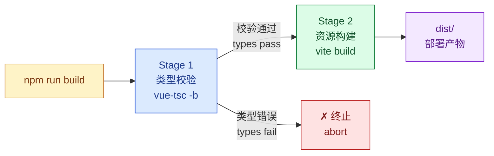
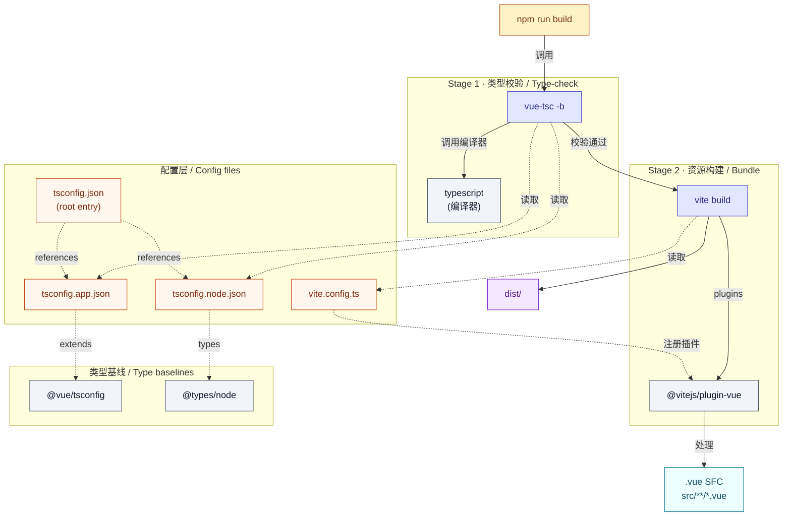
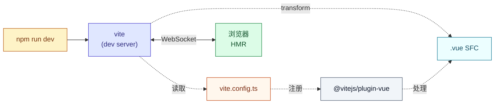

# 项目依赖说明 / Project Dependencies

> 基于初始化后的 `package.json` 整理，记录各包的用途、版本与依赖拓扑关系。
> Brief reference of every package, its role, and the build pipeline topology.

---

## 一、package.json 字段速览 / Field Overview

| 字段 / Field | 值 / Value | 说明 / Meaning |
|---|---|---|
| `name` | `smart-bid-platform-fe` | 项目包名，与本地目录、远程仓库保持一致 / Project identifier |
| `private` | `true` | 私有项目，禁止发布到 npm 公网 / Block accidental publish |
| `version` | `0.0.0` | 初始版本，迭代后按 semver 升级 / Initial semver |
| `type` | `module` | 启用 ESM，`vite.config.ts` 与业务代码统一 `import/export` / ES Module mode |
| `scripts` | dev / build / preview | 启动 / 打包 / 预览 / Run / Bundle / Preview |
| `dependencies` | 见下 / see below | 运行依赖，**打入 dist** / Runtime libs, bundled into `dist` |
| `devDependencies` | 见下 / see below | 开发依赖，**不打包** / Dev-only, not shipped |

---

## 二、scripts 脚本 / Scripts

| 命令 / Command | 实际执行 / Runs | 用途 / Purpose |
|---|---|---|
| `npm run dev` | `vite` | 启动开发服务器，HMR 热更新 / Dev server with HMR |
| `npm run build` | `vue-tsc -b && vite build` | 类型校验 + 打包输出 `dist/` / Type-check then bundle |
| `npm run preview` | `vite preview` | 本地预览已构建的 `dist/` 产物 / Preview built artifacts |

> `&&` 的语义：vue-tsc 类型校验**失败则终止**，不会进入 vite build，从源头避免带 bug 上线。
> `&&` semantics: if type-check fails, build aborts — bugs can't slip into `dist`.

---

## 三、dependencies（运行依赖 / Runtime）

| 包 / Package | 版本 / Version | 角色 / Role |
|---|---|---|
| `vue` | `^3.5.39` | 唯一运行依赖：响应式框架 + SFC 运行时 / Only runtime dep: reactive framework |

> `^` 表示兼容同大版本内的小/补丁更新，不会跨 major。
> `^` means compatible minor/patch upgrades within the same major version.

---

## 四、devDependencies（开发依赖 / Development）

| 包 / Package | 版本 / Version | 角色 / Role |
|---|---|---|
| `vite` | `^8.1.1` | 构建工具本体：dev server、HMR、生产打包 / Build tool core |
| `@vitejs/plugin-vue` | `^6.0.7` | Vite 识别 `.vue` SFC 的官方插件 / Official Vue SFC plugin |
| `vue-tsc` | `^3.3.5` | Vue 专用 TS 校验器，识别 SFC 内 `<template>`/`<script>` 类型 / Vue-aware TS checker |
| `typescript` | `~6.0.2` | TS 编译器本体，被 vue-tsc 调用 / TS compiler, invoked by vue-tsc |
| `@vue/tsconfig` | `^0.9.1` | Vue 官方 tsconfig 基线配置，被业务 / 节点配置继承 / Vue-official tsconfig baseline |
| `@types/node` | `^24.13.2` | Node 24 内置 API 的 TS 类型，用于 `vite.config.ts` / Node 24 type defs |

> `~` 表示仅允许补丁更新，锁在 6.0.x。
> `~` locks to patch updates only (6.0.x).

---

## 五、构建链路拓扑 / Build Pipeline Topology

`npm run build` 内部是**两阶段流水线**，先校验后构建，阶段之间是严格串行的硬依赖（hard dependency）。

### 5.1 阶段总览 / Stages

### 5.2 完整拓扑图 / Full Topology

下图把库（lib）、配置文件（cfg）、阶段（stage）三类节点分开，箭头方向表示「调用 / 读取 / 继承」。

### 5.3 拓扑关系详释 / Edge Semantics

把上图中的箭头按「含义」分类，便于排错时定位：

| 边 / Edge | 类型 / Type | 含义 / Meaning |
|---|---|---|
| `npm run build → vue-tsc` | 顺序触发 / sequential | 阶段 1 入口；脚本中 `vue-tsc -b` 先执行 |
| `npm run build → vite build` | 顺序触发 / sequential | 阶段 2 入口；`&&` 保证阶段 1 成功后才执行 |
| `vue-tsc → typescript` | 内部调用 / internal | vue-tsc 是 TS 编译器的封装，类型检查实际由 typescript 完成 |
| `vue-tsc ⇢ tsconfig.app.json` | 配置读取 / read | 校验 `src/**/*.ts`、`src/**/*.vue` 的类型 |
| `vue-tsc ⇢ tsconfig.node.json` | 配置读取 / read | 校验 `vite.config.ts` 等构建脚本的类型 |
| `tsconfig.json ⇢ tsconfig.app.json` | references | 项目级入口通过 references 引入子配置（不复制内容） |
| `tsconfig.json ⇢ tsconfig.node.json` | references | 同上，对应 Node 环境 |
| `tsconfig.app.json ⇢ @vue/tsconfig` | extends | 继承 Vue 官方 tsconfig 基线（含 DOM lib、Volar 支持） |
| `tsconfig.node.json ⇢ @types/node` | types | 引入 Node API 类型，让 `process.cwd()` 等可被识别 |
| `vite build → vite` | 本体调用 / self | vite 既是命令也是包，构建逻辑在 `vite` 包内 |
| `vite build ⇢ vite.config.ts` | 配置读取 / read | 构建前自动加载项目根的 `vite.config.ts` |
| `vite.config.ts ⇢ @vitejs/plugin-vue` | 插件注册 / register | 在 `plugins: [vue()]` 中显式注册 |
| `@vitejs/plugin-vue ⇢ .vue SFC` | 文件处理 / transform | 把 `.vue` 文件拆分为 `<template>/<script>/<style>` 并送入对应编译器 |

### 5.4 Dev 模式（`npm run dev`）/ Dev Topology

> Dev 模式下**不经过 vue-tsc**，类型错误仅在 IDE（Volar）提示；如需 dev 期也做类型检查，可加 `vue-tsc --watch`。
> Dev mode skips `vue-tsc`. Type errors surface only via IDE (Volar). Add `vue-tsc --watch` for in-dev type checking.

---

## 六、配套文件 / Companion Files

| 文件 / File | 类型 / Type | 是否提交 / Commit? | 说明 / Note |
|---|---|---|---|
| `package.json` | 人工维护 / hand-edited | ✅ 是 / yes | 依赖清单 + 脚本 / Deps + scripts |
| `package-lock.json` | 自动生成 / generated | ✅ **必须** / **must** | 锁死每个传递依赖的精确版本 / Pinned versions |
| `vite.config.ts` | 人工维护 / hand-edited | ✅ 是 / yes | 构建配置（代理、别名、插件）/ Build config |
| `tsconfig.json` | 人工维护 / hand-edited | ✅ 是 / yes | 类型入口，references 两份子配置 / TS entry |
| `tsconfig.app.json` | 人工维护 / hand-edited | ✅ 是 / yes | 业务代码类型规则（src/）/ App code rules |
| `tsconfig.node.json` | 人工维护 / hand-edited | ✅ 是 / yes | 构建脚本类型规则 / Build script rules |
| `index.html` | 人工维护 / hand-edited | ✅ 是 / yes | Vite 入口 HTML / Vite entry |
| `node_modules/` | 自动生成 / generated | ❌ 否 / no | 由 `npm install` 还原 / Restored via install |
| `dist/` | 构建产物 / build output | ❌ 否 / no | 部署时由 CI 重新构建 / Rebuilt by CI |

---

## 七、待补充 / Future Additions

当前只装了 Vue + Vite 最小集。后续按业务需要会逐步加入：

- **路由 / Routing**: `vue-router`
- **状态管理 / State**: `pinia`
- **HTTP**: `axios`
- **UI 库 / UI kit**: `element-plus` / `ant-design-vue` / `naive-ui`
- **代码规范 / Lint**: `eslint` + `@vue/eslint-config-typescript` + `prettier`
- **Git hooks**: `husky` + `lint-staged`
- **样式 / Styling**: `sass` 或 `unocss`

每加一个新包，建议同步在本文件追加其角色与拓扑变化。
When adding a new package, append its role and topology impact here.
